# Intro


# Getting started

1. Write Raspberry Pi OS to sd-card with the use of Raspberry Pi Imager.
   * lite distribution is enough
   * configure login and wifi

1. call the following script 
   * for main:
     ```
     nohup sh -c "curl https://raw.githubusercontent.com/an-dr-eas-k/the-alarm-clock/main/rpi/setup.sh | bash -s" &
     ```

   * for develop:
     ```
     nohup sh -c "curl https://raw.githubusercontent.com/an-dr-eas-k/the-alarm-clock/refs/heads/develop/rpi/setup.sh | bash -s" &
     ```

    * after: 
      ```
      reboot
      ```

    * repeat:
      ```
      nohup sh -c "curl https://raw.githubusercontent.com/an-dr-eas-k/the-alarm-clock/refs/heads/develop/rpi/setup.sh | bash -s -- --fast" &
      ```

1. follow the log output with
   * for the application itself
     ```
     journalctl -u the-alarm-clock.service -f
     ```
   * for the spotify client (raspotify/librespot)
     ```
     journalctl -u raspotify.service -f
     ```

# Dependencies
7 Segment Font is included from https://github.com/keshikan/DSEG/releases \
weather symbols are included from https://github.com/erikflowers/weather-icons


# Tests

Unit tests live in `tests/`, mirroring the `src/core/...` package layout, and
run with the standard library `unittest` (no extra tooling required). They
are offline and hardware-free: GPIO, I2C/SPI, the OLED display, ALSA, VLC and
network access are all mocked.

Run the whole suite from the repository root (using your project's virtual
environment):
```
.venv/bin/python -m unittest discover -s tests -t .
```

Run a single test module, e.g.:
```
.venv/bin/python -m unittest tests.domain.test_model
```


# Box

## Simple


# Connection Guide

## Wiring Overview

```mermaid
flowchart TB
  V33(["3.3 V rail"])

  subgraph RPI["Raspberry Pi (40-pin header)"]
    direction LR
    P3V3["3V3 (pin 17)"]
    G10["GPIO10 / MOSI (pin 19)"]
    G11["GPIO11 / SCLK (pin 23)"]
    G8["GPIO8 / CE0 (pin 24)"]
    G24["GPIO24 (pin 18)"]
    G25["GPIO25 (pin 22)"]
    G5["GPIO5 (pin 29)"]
    G6["GPIO6 (pin 31)"]
    G13["GPIO13 (pin 33)"]
    G12["GPIO12 (pin 32)"]
    G1["GPIO1 (pin 28)"]
    G26["GPIO26 (pin 37)"]
    PGND["GND (pin 39)"]
  end

  subgraph DISP["OLED display (SPI)"]
    direction LR
    D_VBAT["VBAT"]
    D_SDI["SDI"]
    D_SCLK["SCLK"]
    D_CS["CS"]
    D_DC["DC"]
    D_RES["RESET"]
    D_VSS["VSS"]
  end

  subgraph ROT["Rotary encoder"]
    direction LR
    R_PRESS["push switch"]
    R_A["A"]
    R_B["B"]
    R_COM["common"]
  end

  subgraph BTN["Buttons"]
    direction LR
    B_MODE["mode button"]
    B_INV["invoke button"]
    B_GND["other contacts"]
  end

  subgraph LIGHT["Brightness sensor (RC)"]
    direction LR
    LDR["photoresistor GL5539"]
    CAP["capacitor 10 nF"]
  end

  AMP["DigiAMP+ (I2S audio)<br/>plugged onto the header<br/>GPIO18, 19, 20, 21"]

  GND(["GND rail"])

  V33 ---|once| P3V3
  V33 --- D_VBAT
  V33 --- LDR

  G10 ---|white| D_SDI
  G11 ---|brown| D_SCLK
  G8 ---|blue| D_CS
  G24 ---|gray| D_DC
  G25 ---|pink| D_RES

  G5 --- R_PRESS
  G6 --- R_A
  G13 --- R_B
  G12 --- B_MODE
  G1 --- B_INV
  G26 --- LDR
  G26 --- CAP

  RPI -.-|I2S| AMP

  PGND ---|once| GND
  D_VSS ---|black| GND
  R_COM --- GND
  B_GND --- GND
  CAP --- GND
```



Buttons and the rotary encoder are read with the Pi's internal pull-ups, so
they only need to short their GPIO to GND. The brightness sensor measures the
charge time of the capacitor through the photoresistor (3V3 → photoresistor →
GPIO26 → capacitor → GND).

## RPi GPIO

|         |||||||||
|---------|----------------|--------------|----|---|----|---------|-----------------|---------|
| blue    |  i2c (vcc)     |    3V3       |  1 |   |  2 |     5V  |                 |         |
| green   |  i2c (sda)     | GPIO02       |  3 |   |  4 |     5V  |                 |         |
| yellow  |  i2c (scl)     | GPIO03       |  5 |   |  6 |    GND  |                 |         |
| purple  |  i2c (int)     | GPIO04       |  7 |   |  8 | GPIO14  |                 |         |
|         |                |    GND       |  9 |   | 10 | GPIO15  |                 |         |
|         |                | GPIO17       | 11 |   | 12 | GPIO18  | i2s (digiamp+)  |         |
|         |                | GPIO27       | 13 |   | 14 |    GND  |                 |         |
|         |                | GPIO22       | 15 |   | 16 | GPIO23  |                 |         |
| red     | spi (vbat, 2)  |    3V3       | 17 |   | 18 | GPIO24  | spi (   dc, 14) |   gray  |
| white   | spi ( sdi, 5)  | GPIO10       | 19 |   | 20 |    GND  | spi (  vss,  1) |  black  |
|         |                | GPIO09       | 21 |   | 22 | GPIO25  | spi (reset, 15) |   pink  |
| brown   | spi (sclk, 4)  | GPIO11       | 23 |   | 24 | GPIO08  | spi (   cs, 16) |   blue  |
|         |                |    GND       | 25 |   | 26 | GPIO07  |                 |         |
|         |                | GPIO00       | 27 |   | 28 | GPIO01  | invoke_button   |         |
|         | rot_press      | GPIO05       | 29 |   | 30 |    GND  |                 |         |
|         | rot_a          | GPIO06       | 31 |   | 32 | GPIO12  | mode_button     |         |
|         | rot_b          | GPIO13       | 33 |   | 34 |    GND  |                 |         |
|         | i2s (digiamp+) | GPIO19       | 35 |   | 36 | GPIO16  |                 |         |
|         |                | GPIO26       | 37 |   | 38 | GPIO20  |  i2s (digiamp+) |         |
| black   | ground term    |    GND       | 39 |   | 40 | GPIO21  |  i2s (digiamp+) |         |


## MCP 23017

|         |||||||||
|---------|--------------|----|----------|--------|---------------|---------|----------|---------------|
|         |    A3        |    | VCC      |  blue  | BH1759        | GND     |          |               |
|         |    A2        |    | ITB *1   |        |               | ITA *1  |  purple  | rpi gpio4     |
|         |    A1        |    | B0       |  brown | rotary button | A0      |  white   | mode button   |
|         |    Reset     |    | B1       |  black | rotary 1      | A1      |  grey    | invoke button |
|         |    NC        |    | B2       |  red   | rotary 2      | A2      |          |               |
|         |    NC        |    | B3       |        |               | A3      |          |               |
| green   |    SDA       |    | B4       |        |               | A4      |          |               |
| orange  |    SCL       |    | B5       |        |               | A5      |          |               |
| purple  |    GND       |    | B6       |        |               | A6      |          |               |
| orange  |    VCC       |    | B7       |        |               | A7      |          |               |

# State Diagram

|State|1|2|3|4| Comment|
|------|-----|-----|--|--| --|
|Default|Default,<br>Volume Timer|Default,<br> Volume Timer|AlarmView|Media On, Playing|
|Volume Timer | 
|AlarmView | AlarmView,<br>Previous Alarm | AlarmView,<br>Next Alarm | Default|AlarmEdit |There is a `new Alarm` Alarm|
|AlarmEdit | AlarmEdit,<br>Previous Property|AlarmEdit,<br>Next Property|Default|PropertyEdit|There is a `save` Property|
|PropertyEdit | PropertyEdit,<br>Value Down | PropertyEdit,<br>Value Up| Default | AlarmEdit|

# Devices
## Rotary Encoder
## Light Sensor: photoresistor (GL5539) + capacitor (10nF) RC bridge
3.3V -> photoresistor -> GPIO26 -> capacitor -> GND. Brightness is derived from how
long GPIO26 takes to charge through the photoresistor (see `core/infrastructure/brightness_sensor.py`).
## Port Expander 16-Bit-I/O MCP23017 
## Sound card DigiAMP+
